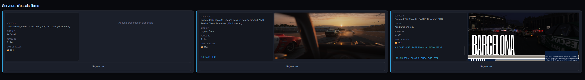

# English

## QARL {{VERSION}} — Online servers, layout and quality fixes

- Added three free-practice server cards with live server details, descriptions and images when available.
- Recent and saved servers now appear side by side, and the opponent list makes better use of the sidebar space.
- Fixed Svelte and TypeScript errors and accessibility warnings across the interface.

# Français

## QARL {{VERSION}} — Serveurs en ligne, interface et correctifs

- Ajout de trois cartes de serveurs d’essais libres avec leurs informations en direct, leur descriptif et leurs images lorsqu’elles sont disponibles.
- Les serveurs récents et enregistrés sont maintenant côte à côte, et la liste des adversaires utilise mieux l’espace de la barre latérale.
- Correction des erreurs Svelte et TypeScript ainsi que des avertissements d’accessibilité dans l’interface.

# Deutsch

## QARL {{VERSION}} — Online-Server, Oberfläche und Fehlerbehebungen

- Drei Karten für Server zum freien Üben hinzugefügt, mit aktuellen Serverinformationen, Beschreibung und verfügbaren Bildern.
- Zuletzt verwendete und gespeicherte Server werden jetzt nebeneinander angezeigt. Außerdem nutzt die Gegnerliste den Platz in der Seitenleiste besser.
- Svelte- und TypeScript-Fehler sowie Barrierefreiheitswarnungen in der Oberfläche wurden behoben.

# Español

## QARL {{VERSION}} — Servidores online, interfaz y correcciones

- Se han añadido tres tarjetas de servidores de práctica libre con información en directo, descripción e imágenes cuando están disponibles.
- Los servidores recientes y guardados ahora aparecen uno al lado del otro, y la lista de rivales aprovecha mejor el espacio de la barra lateral.
- Se han corregido errores de Svelte y TypeScript y advertencias de accesibilidad en la interfaz.

# Italiano

## QARL {{VERSION}} — Server online, interfaccia e correzioni

- Aggiunte tre schede per i server di pratica libera con informazioni in tempo reale, descrizione e immagini quando disponibili.
- I server recenti e salvati sono ora affiancati e l’elenco degli avversari sfrutta meglio lo spazio della barra laterale.
- Corretti gli errori Svelte e TypeScript e gli avvisi di accessibilità nell’interfaccia.
