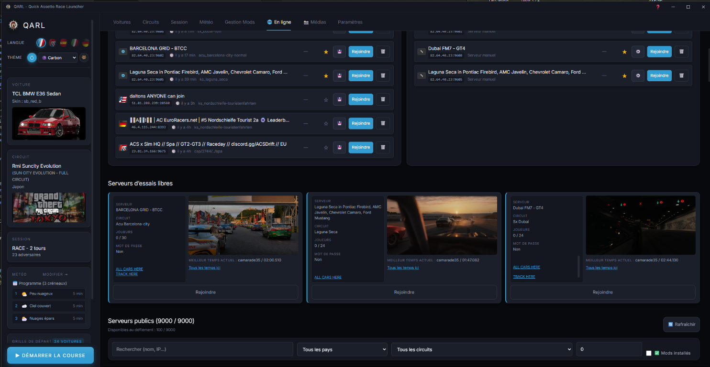

# English

## QARL {{VERSION}} — Set your time on the QARL servers!

The three featured free-practice servers are QARL's own servers. Join the challenge, set a lap time and see how you compare! ;)

- Each server card shows the fastest stored lap and driver from the current event, with a link to the full live timing page. Stored times are for drivers who have disconnected; they are not permanent records.
- Times refresh every 90 seconds while the Online tab is open. If a time is unavailable or none has been recorded, the card says so.
- Fixed the game port used when joining servers that advertise separate TCP and UDP ports.

# Français

## QARL {{VERSION}} — À vous de signer un chrono sur les serveurs QARL !

Les trois serveurs d'essais libres mis en avant sont les serveurs de QARL. Relevez le défi : rejoignez-les, réalisez un temps et comparez-vous aux autres ! ;)

- Chaque vignette affiche le meilleur temps enregistré et le pseudo pour l'événement en cours, avec un lien vers la page complète du live timing. Les temps enregistrés sont ceux des pilotes déconnectés ; ce ne sont pas des records permanents.
- Les chronos sont actualisés toutes les 90 secondes lorsque l'onglet En ligne est ouvert. La vignette indique si aucun temps n'est enregistré ou si les chronos sont indisponibles.
- Correction du port de jeu utilisé pour rejoindre les serveurs qui annoncent des ports TCP et UDP distincts.

# Deutsch

## QARL {{VERSION}} — Fahre deine Zeit auf den QARL-Servern!

Die drei hervorgehobenen Trainingsserver sind QARLs eigene Server. Nimm die Herausforderung an, fahre eine Rundenzeit und vergleiche dich mit den anderen! ;)

- Jede Serverkachel zeigt die schnellste gespeicherte Runde und den Fahrernamen des aktuellen Events sowie einen Link zum vollständigen Live-Timing. Gespeicherte Zeiten stammen von Fahrern, die den Server verlassen haben; es sind keine dauerhaften Rekorde.
- Die Zeiten werden bei geöffnetem Online-Tab alle 90 Sekunden aktualisiert. Die Kachel zeigt an, wenn keine Zeit gespeichert oder der Dienst nicht verfügbar ist.
- Der zum Beitreten verwendete Spielport wurde für Server mit getrennten TCP- und UDP-Ports korrigiert.

# Español

## QARL {{VERSION}} — ¡Marca tu tiempo en los servidores de QARL!

Los tres servidores de prácticas destacados son los propios servidores de QARL. Acepta el desafío, marca una vuelta y compárate con los demás. ;)

- Cada tarjeta muestra la mejor vuelta guardada y el nombre del piloto del evento actual, con un enlace a la página completa de tiempos en vivo. Los tiempos guardados corresponden a pilotos desconectados; no son récords permanentes.
- Los tiempos se actualizan cada 90 segundos mientras la pestaña En línea está abierta. La tarjeta indica si no hay tiempos guardados o si no están disponibles.
- Corregido el puerto de juego utilizado para entrar en servidores que anuncian puertos TCP y UDP distintos.

# Italiano

## QARL {{VERSION}} — Segna il tuo tempo sui server QARL!

I tre server di prove libere in evidenza sono i server di QARL. Accetta la sfida, segna un giro e confrontati con gli altri! ;)

- Ogni riquadro mostra il miglior giro salvato e il nome del pilota dell'evento in corso, con un link alla pagina completa dei tempi live. I tempi salvati appartengono ai piloti disconnessi e non sono record permanenti.
- I tempi si aggiornano ogni 90 secondi quando la scheda Online è aperta. Il riquadro indica se non ci sono tempi salvati o se non sono disponibili.
- Corretta la porta di gioco usata per entrare nei server che indicano porte TCP e UDP distinte.
