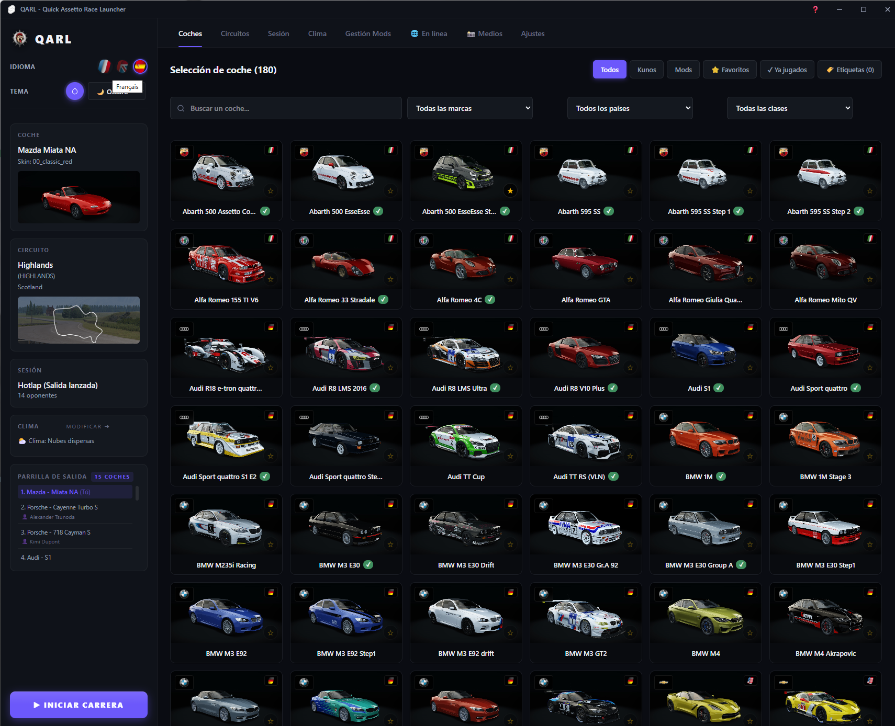
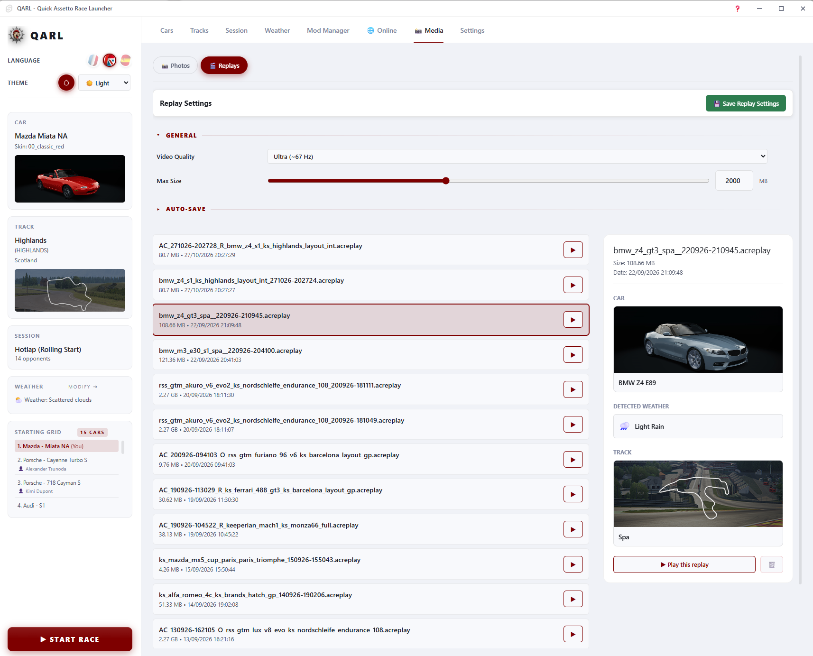
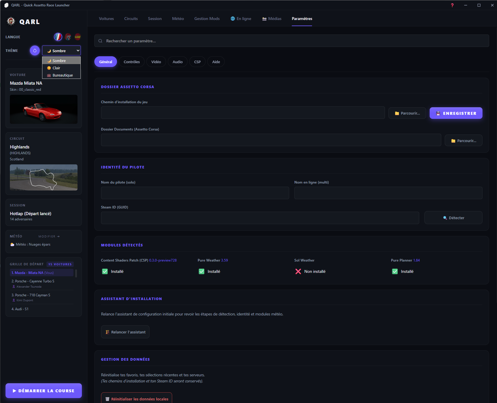
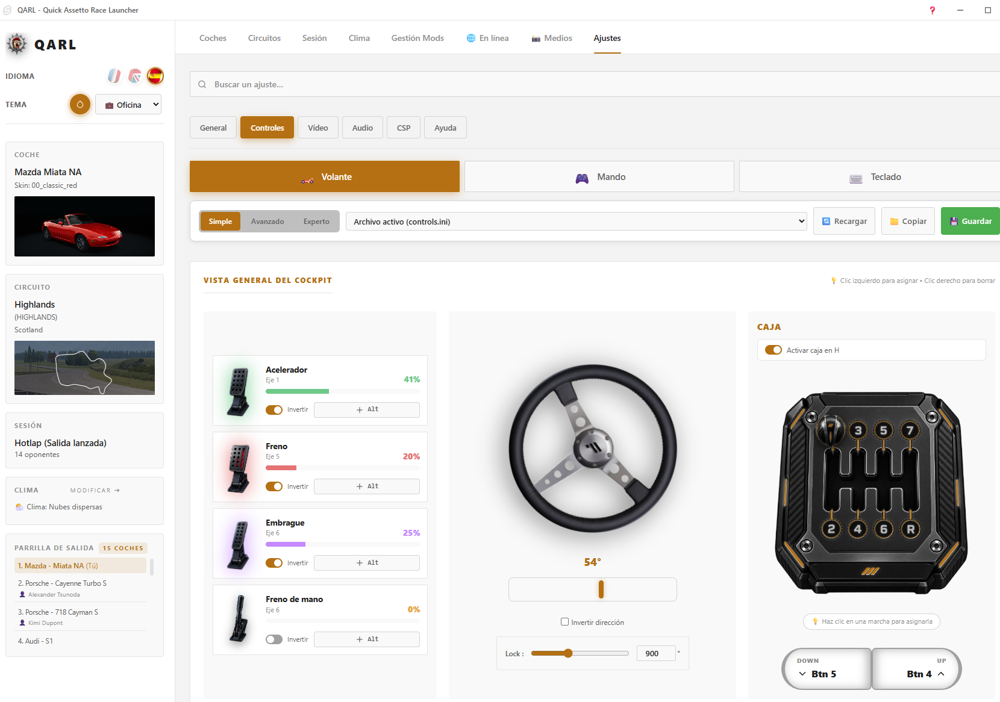
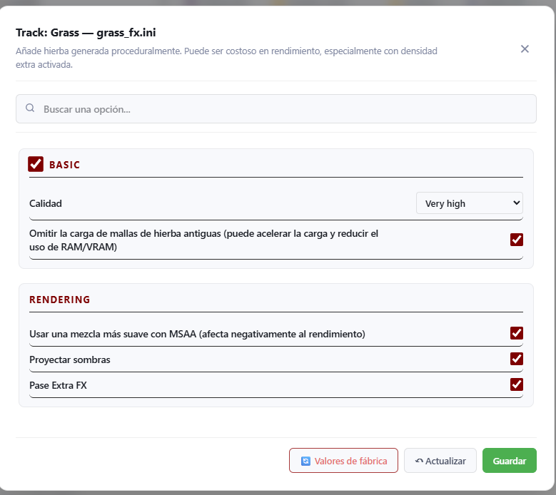
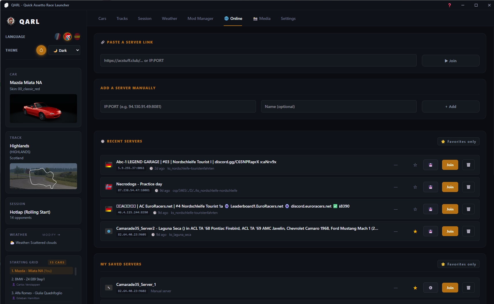

# 🏎️ QARL - Quick Assetto Race Launcher

QARL est un launcher moderne, rapide et élégant pour **Assetto Corsa**. Développé avec **Tauri** et **Svelte**, il offre une expérience utilisateur fluide, entièrement traduite, avec un support complet pour Custom Shaders Patch (CSP), Sol et Pure Weather.

## ✨ Fonctionnalités Principales

- **Multi-thèmes & Couleurs** : 3 thèmes inclus (Sombre, Clair, Bureautique) et choix de la couleur d'accentuation.
- **Support Multi-langues** : Interface traduite en Français, Anglais et Espagnol.
- **Météo Avancée** : Support natif de Pure et Sol (Plans personnalisés, Timed, Daycycle) et du Schedule dynamique de CSP.
- **Gestion des Médias** : Visualisez, lancez et supprimez vos replays. Gérez vos captures d'écran avec Nice Screenshots (Hints traduits inclus).
- **Configuration Complète** : Paramétrez vos voitures, circuits, sessions, assistants et contrôles (avec détection des périphériques).
- **Gestionnaire de Mods** : Installation simplifiée par glisser-déposer.

---

## 📸 Aperçu de l'interface

| Voitures & Thèmes | Médias & Replays |
| :---: | :---: |
|  |  |
| *Sélection de véhicules avec filtres avancés* | *Gestion des replays avec météo traduite* |

| Paramètres & Modules | Contrôles (Thème Bureautique) |
| :---: | :---: |
|  |  |
| *Détection automatique de CSP, Pure et Sol* | *Interface de configuration du volant* |

| Options CSP (Hints traduits) | Personnalisation |
| :---: | :---: |
|  |  |
| *Options CSP avec info-bulles traduites* | *Sélecteur de couleur d'accentuation* |

---

## 🛠️ Stack Technique

- **Frontend** : SvelteKit (Svelte 5) + TailwindCSS
- **Backend** : Rust (via Tauri v2)
- **Cibles** : Windows (principalement), compatible Mac/Linux avec Tauri.

## 🚀 Installation (Développement)

Si vous souhaitez compiler QARL vous-même :

### Prérequis
- [Node.js](https://nodejs.org/) (v18+)
- [Rust](https://www.rust-lang.org/tools/install)
- [Tauri CLI](https://v2.tauri.app/fr/start/)

### Lancement
```bash
# Cloner le dépôt
git clone https://github.com/camarade35/QARL.git
cd QARL

# Installer les dépendances frontend
npm install

# Lancer l'application en mode développement
npm run tauri dev