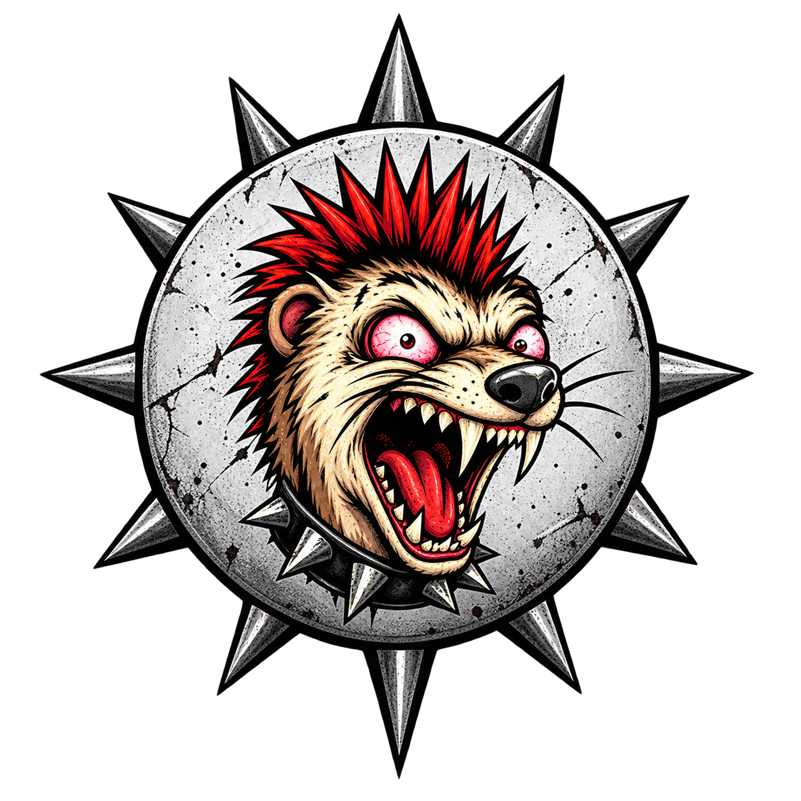
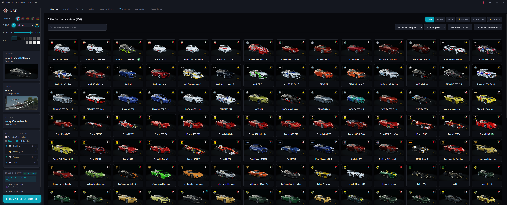
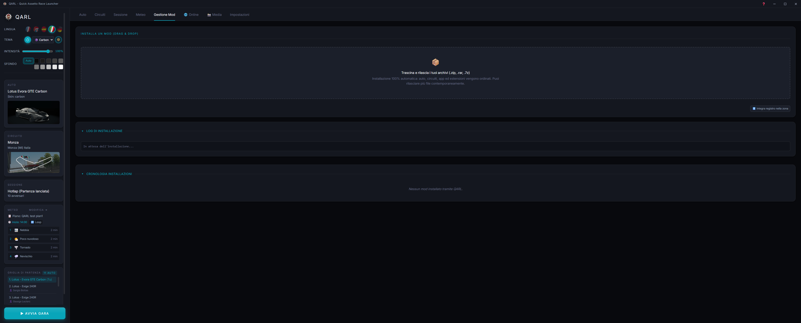
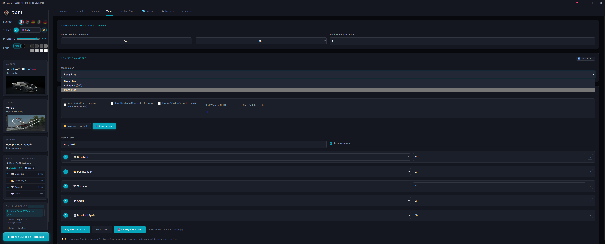
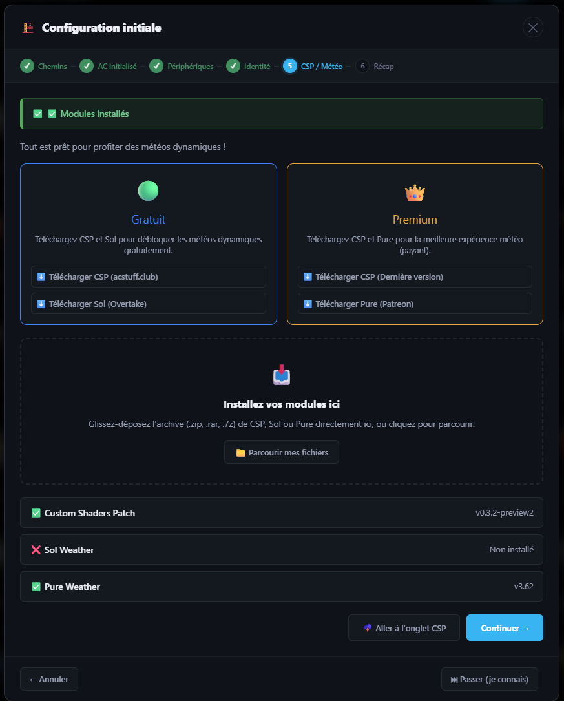

  
  <h1>QARL - Quick Assetto Racing Launcher</h1>
  
<i>Un launcher moderne, rapide et simple. Fait par passion, pour la communauté.</i>

  
  

---

## 🇫🇷 L'histoire derrière QARL

Comme beaucoup d'entre vous, j'ai passé des milliers d'heures sur Assetto Corsa. J'ai vu ce jeu grandir grâce à des gens formidables. **Sans Content Manager, QARL n'existerait pas.** C'est la base de tout. Je voulais juste rendre hommage à ce travail et proposer quelque chose de nouveau, quelque chose de moderne.

Je ne suis pas là pour réinventer la roue. J'ai fait QARL pour me faciliter la vie, et j'espère qu'il facilitera la vôtre. 

**Pourquoi QARL ?**
Parce que je voulais une interface qui ressemble à ce qu'on fait aujourd'hui, ultra rapide grâce à Rust, et qui ne me demande pas de configurer 15 choses avant de pouvoir rouler. 

Le point de départ, c'est **l'Assistant de premier démarrage**. Il détecte votre jeu, vérifie vos périphériques, votre Steam ID, et vous permet d'installer **CSP, Sol ou Pure directement depuis l'application**. Pas de prérequis complexes, on vous guide pas à pas.

C'est un outil pour la communauté, pour qu'on puisse tous continuer à profiter de ce jeu incroyable.

### Ce qu'il contient
*   **Un assistant de configuration** pour tout installer en 2 minutes (CSP/Pure inclus).
*   **Un cache Rust** pour un chargement instantané.
*   **Un gestionnaire de mods** simple (glisser-déposer).
*   **Une interface traduite en 5 langues**, claire et moderne.

---

### 📸 Aperçu de QARL

| **L'interface principale** | **Le guide visuel intégré** |
| :---: | :---: |
|  |  |
| *Sélectionnez vos voitures et circuits en un éclair.* | *Un onglet Aide complet pour tout comprendre.* |

| **Gestion des Mods (Drag & Drop)** | **Météo Dynamique (Pure/Sol)** |
| :---: | :---: |
|  |  |
| *Glissez, déposez, QARL s'occupe du reste.* | *Créez des plans météo complexes en quelques clics.* |

 

  
  
<i>L'Assistant de premier démarrage : la clé de voûte de QARL.</i>

---

### 🚀 Installation
1. Téléchargez la dernière version sur la page **[Releases](https://github.com/camarade35/QARL/releases)**.
2. Lancez QARL.
3. Suivez l'assistant pour configurer votre jeu et installer vos modules (CSP/Pure).
4. C'est prêt. Bonne course.

**Crédits et Remerciements :**
Un immense merci à **Kunos Simulazioni** pour Assetto Corsa, à **Peter Boese** (Pure), **Ilja Jusupov** (CSP) et **Sol**. Et une pensée spéciale à la communauté d'**Overtake.gg** et aux créateurs de **Content Manager** sans qui rien de tout cela ne serait possible. 

*Licence : GPLv3*

---

🇬🇧 <b>Click here for the English version</b>

 

## 🇬🇧 The story behind QARL

Like many of you, I've spent thousands of hours in Assetto Corsa. I've seen this game grow thanks to amazing people. **Without Content Manager, QARL wouldn't exist.** It is the foundation. I just wanted to pay tribute to that work and offer something new, something modern.

I'm not trying to reinvent the wheel. I built QARL to make my life easier, and I hope it makes yours easier too.

**Why QARL?**
Because I wanted an interface that looks like what we make today, blazing fast thanks to Rust, and one that doesn't ask me to configure 15 things before I can drive.

The starting point is the **First-Start Wizard**. It detects your game, checks your controllers, your Steam ID, and allows you to install **CSP, Sol, or Pure directly from the app**. No complex prerequisites, just step-by-step guidance.

It's a tool for the community, so we can all keep enjoying this incredible game.

### What's inside
*   **A setup wizard** to install everything in 2 minutes (CSP/Pure included).
*   **A Rust cache** for instant loading.
*   **A simple mod manager** (drag & drop).
*   **An interface translated into 5 languages**, clean and modern.

### 📸 Screenshots
| **Main Interface** | **Built-in Visual Guide** |
| :---: | :---: |
|  |  |

| **Mod Manager (Drag & Drop)** | **Dynamic Weather (Pure/Sol)** |
| :---: | :---: |
|  |  |

 

  

**Credits & Thanks:**
A huge thank you to **Kunos Simulazioni** for Assetto Corsa, to **Peter Boese** (Pure), **Ilja Jusupov** (CSP) and **Sol**. And a special thought to the **Overtake.gg** community and the creators of **Content Manager**, without whom none of this would be possible.

*License: GPLv3*

🇪🇸 <b>Haz clic aquí para la versión en Español</b>

 

## 🇪🇸 La historia detrás de QARL

Como muchos de ustedes, he pasado miles de horas en Assetto Corsa. He visto crecer este juego gracias a personas increíbles. **Sin Content Manager, QARL no existiría.** Es la base de todo. Solo quería rendir homenaje a ese trabajo y ofrecer algo nuevo, algo moderno.

No estoy tratando de reinventar la rueda. Hice QARL para facilitarme la vida, y espero que también te la facilite a ti.

**¿Por qué QARL?**
Porque quería una interfaz que se viera como lo que hacemos hoy, rapidísima gracias a Rust, y que no me pidiera configurar 15 cosas antes de poder conducir.

El punto de partida es el **Asistente de Primer Inicio**. Detecta tu juego, verifica tus periféricos, tu Steam ID, y te permite instalar **CSP, Sol o Pure directamente desde la aplicación**. Sin requisitos previos complejos, solo una guía paso a paso.

Es una herramienta para la comunidad, para que todos podamos seguir disfrutando de este juego increíble.

### 📸 Capturas de pantalla
| **Interfaz principal** | **Guía visual integrada** |
| :---: | :---: |
|  |  |

| **Gestor de Mods** | **Clima Dinámico** |
| :---: | :---: |
|  |  |

**Créditos y Agradecimientos:**
Un enorme agradecimiento a **Kunos Simulazioni** por Assetto Corsa, a **Peter Boese** (Pure), **Ilja Jusupov** (CSP) y **Sol**. Y un pensamiento especial a la comunidad de **Overtake.gg** y a los creadores de **Content Manager**, sin quienes nada de esto sería posible.

*Licencia: GPLv3*

🇩🇪 <b>Klicke hier für die deutsche Version</b>

 

## 🇩🇪 Die Geschichte hinter QARL

Wie viele von euch habe ich Tausende von Stunden in Assetto Corsa verbracht. Ich habe gesehen, wie dieses Spiel dank großartiger Menschen gewachsen ist. **Ohne Content Manager würde QARL nicht existieren.** Es ist die Grundlage für alles. Ich wollte diese Arbeit nur würdigen und etwas Neues, etwas Modernes anbieten.

Ich versuche nicht, das Rad neu zu erfinden. Ich habe QARL gebaut, um mir das Leben einfacher zu machen, und ich hoffe, dass es auch deins einfacher macht.

**Warum QARL?**
Weil ich eine Benutzeroberfläche wollte, die so aussieht wie das, was wir heute machen, blitzschnell dank Rust, und die mich nicht auffordert, 15 Dinge zu konfigurieren, bevor ich fahren kann.

Der Ausgangspunkt ist der **Erste-Schritte-Assistent**. Er erkennt dein Spiel, prüft deine Controller, deine Steam-ID und ermöglicht es dir, **CSP, Sol oder Pure direkt aus der App zu installieren**. Keine komplexen Voraussetzungen, nur eine Schritt-für-Schritt-Anleitung.

Es ist ein Werkzeug für die Community, damit wir alle weiterhin dieses unglaubliche Spiel genießen können.

### 📸 Screenshots
| **Hauptoberfläche** | **Integrierter visueller Leitfaden** |
| :---: | :---: |
|  |  |

| **Mod-Manager** | **Dynamisches Wetter** |
| :---: | :---: |
|  |  |

**Credits & Dank:**
Ein riesiges Dankeschön an **Kunos Simulazioni** für Assetto Corsa, an **Peter Boese** (Pure), **Ilja Jusupov** (CSP) und **Sol**. Und ein besonderer Gedanke an die **Overtake.gg**-Community und die Macher von **Content Manager**, ohne die all dies nicht möglich wäre.

*Lizenz: GPLv3*

🇮🇹 <b>Clicca qui per la versione Italiana</b>

 

## 🇮🇹 La storia dietro QARL

Come molti di voi, ho passato migliaia di ore su Assetto Corsa. Ho visto questo gioco crescere grazie a persone fantastiche. **Senza Content Manager, QARL non esisterebbe.** È la base di tutto. Volevo solo rendere omaggio a quel lavoro e offrire qualcosa di nuovo, qualcosa di moderno.

Non sto cercando di reinventare la ruota. Ho creato QARL per semplificarmi la vita, e spero che la semplifichi anche alla tua.

**Perché QARL?**
Perché volevo un'interfaccia che assomigliasse a ciò che facciamo oggi, velocissima grazie a Rust, e che non mi chiedesse di configurare 15 cose prima di poter guidare.

Il punto di partenza è la **Procedura Guidata di Primo Avvio**. Rileva il tuo gioco, controlla i tuoi controller, il tuo Steam ID e ti permette di installare **CSP, Sol o Pure direttamente dall'app**. Nessun prerequisito complesso, solo una guida passo passo.

È uno strumento per la comunità, così possiamo continuare tutti a goderci questo gioco incredibile.

### 📸 Screenshot
| **Interfaccia principale** | **Guida visiva integrata** |
| :---: | :---: |
|  |  |

| **Gestore Mod** | **Meteo Dinamico** |
| :---: | :---: |
|  |  |

**Crediti e Ringraziamenti:**
Un enorme ringraziamento a **Kunos Simulazioni** per Assetto Corsa, a **Peter Boese** (Pure), **Ilja Jusupov** (CSP) e **Sol**. E un pensiero speciale alla community di **Overtake.gg** e ai creatori di **Content Manager**, senza i quali nulla di tutto ciò sarebbe possibile.

*Licenza: GPLv3*

